<p align="center">
  <a href="https://maelsmo.github.io/aurora_ecipse/">
    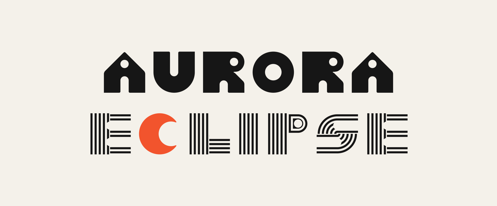
  </a>
</p>

# Aurora Eclipse · Type Lab

**Редактор узоров из букв.** Знаки собираются из модулей на общей сетке, а дальше работают как материал: их можно слить в один знак, размножить клонером в орнамент, уронить на пол с настоящей физикой и забрать результат вектором, растром или видео.

**[Открыть в браузере →](https://maelsmo.github.io/aurora_ecipse/)**

Ставить ничего не нужно. Всё считается в вашем браузере, сцены и сеты хранятся в нём же, на сервер ничего не уходит.

<p align="center">
  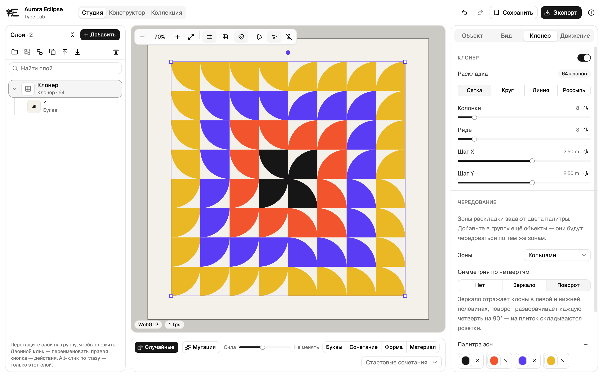
</p>

## Что получается

Каждую картинку ниже рисует само приложение. Ссылка под ней открывает эту сцену в редакторе — дальше её можно менять.

<table>
  <tr>
    <td width="33%">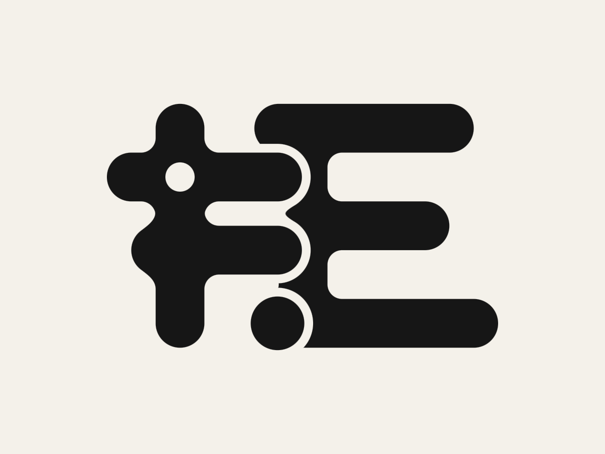<br><b>Затмение</b> — один знак уходит за другой и огибает его с просветом.<br><a href="https://maelsmo.github.io/aurora_ecipse/?preset=eclipse-ae">Открыть</a></td>
    <td width="33%">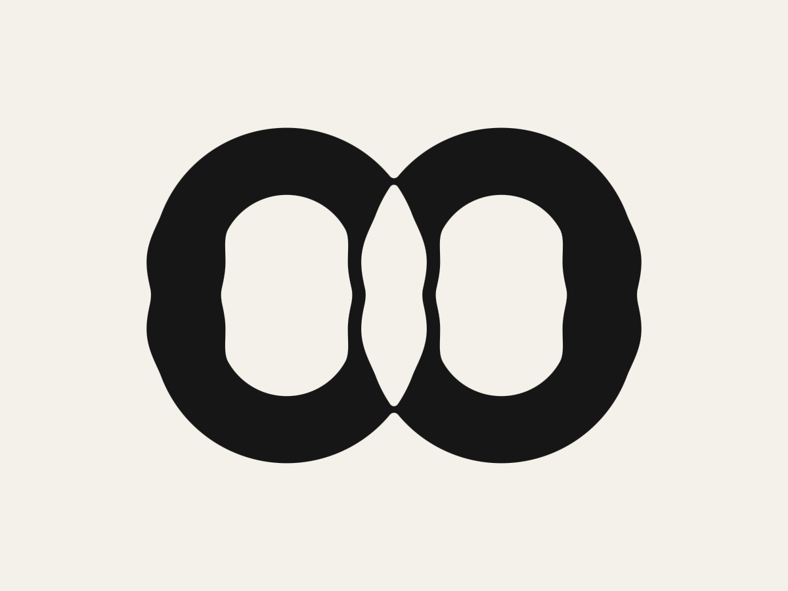<br><b>Орбита</b> — буква ходит вокруг соседки, а их перекрытие становится просветом.<br><a href="https://maelsmo.github.io/aurora_ecipse/?preset=orbit">Открыть</a></td>
    <td width="33%">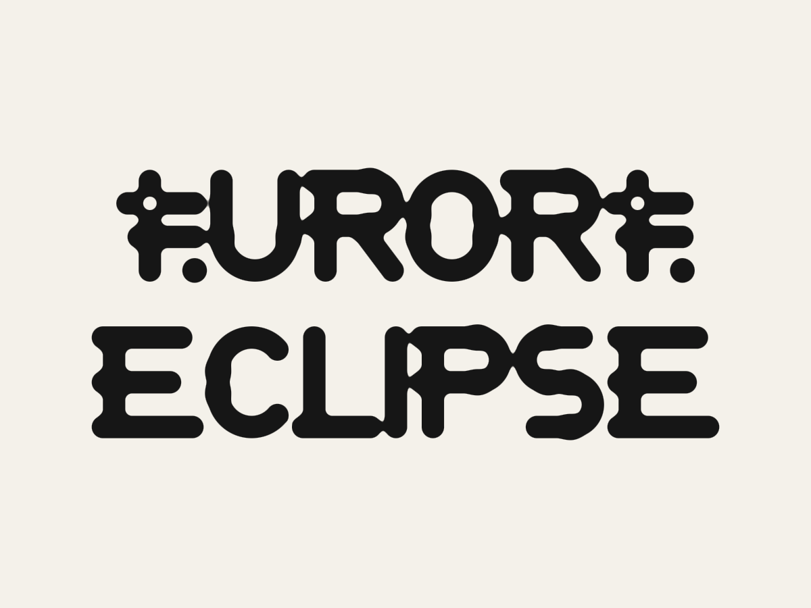<br><b>Надпись</b> — основной сет: штрихи, дуги, спутники.<br><a href="https://maelsmo.github.io/aurora_ecipse/?preset=wordmark">Открыть</a></td>
  </tr>
  <tr>
    <td>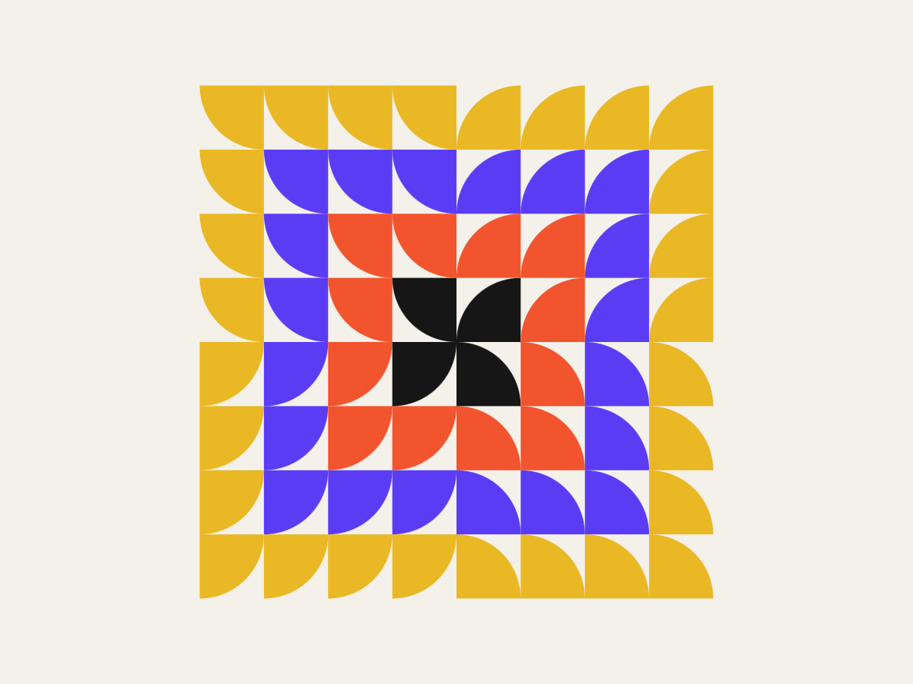<br><b>Розетка</b> — одна плитка, клонер 8 × 8, цвета кольцами, поворот по четвертям.<br><a href="https://maelsmo.github.io/aurora_ecipse/?preset=rosette">Открыть</a></td>
    <td>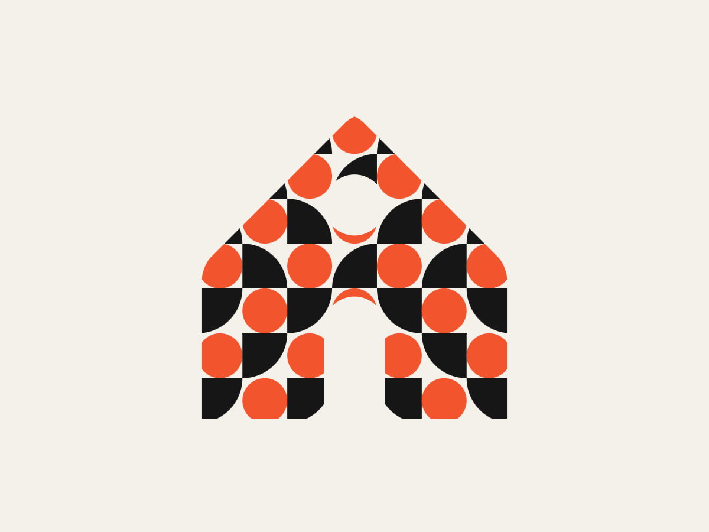<br><b>Буква из плиток</b> — знак работает маской для узора.<br><a href="https://maelsmo.github.io/aurora_ecipse/?preset=letter-mask">Открыть</a></td>
    <td>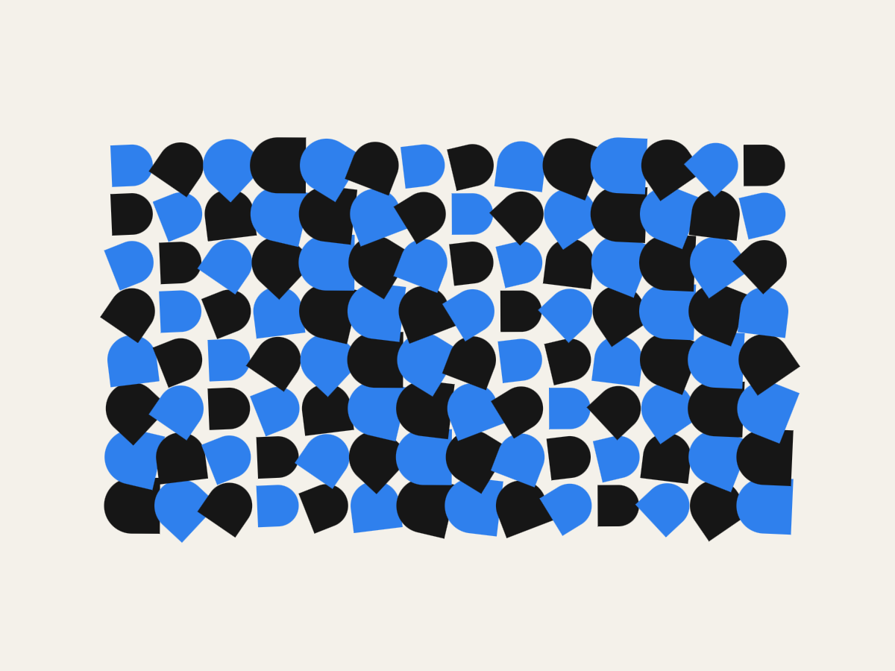<br><b>Волна плиток</b> — эффектор качает клоны во времени.<br><a href="https://maelsmo.github.io/aurora_ecipse/?preset=tile-wave">Открыть</a></td>
  </tr>
  <tr>
    <td>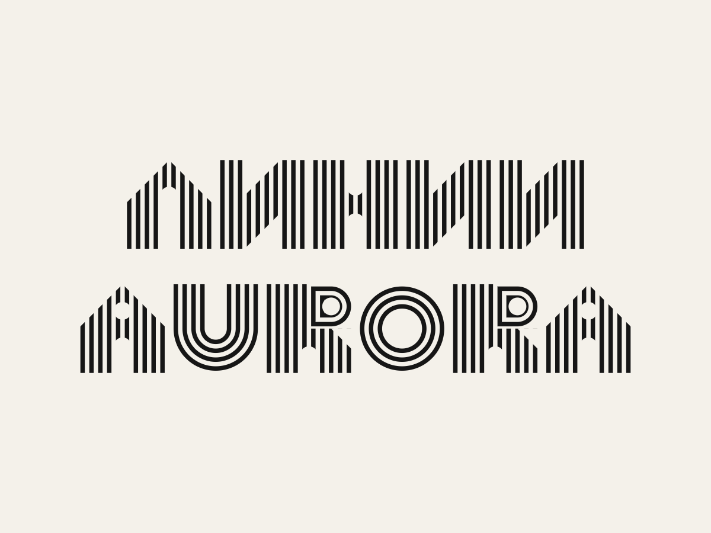<br><b>Линии</b> — те же буквы пучками параллельных линий.<br><a href="https://maelsmo.github.io/aurora_ecipse/?preset=geo-lines">Открыть</a></td>
    <td>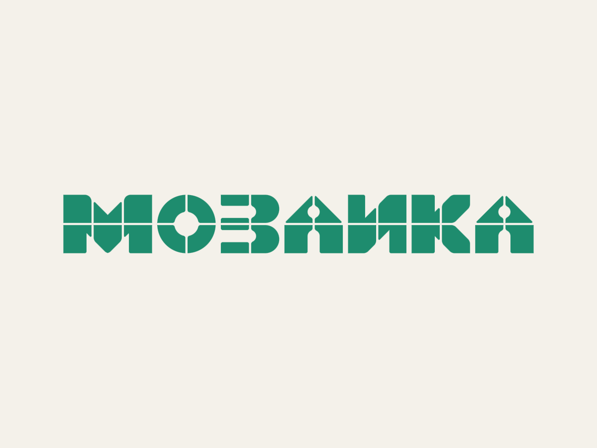<br><b>Мозаика</b> — зазор раскрывает клетки, из которых сложена буква.<br><a href="https://maelsmo.github.io/aurora_ecipse/?preset=mosaic">Открыть</a></td>
    <td>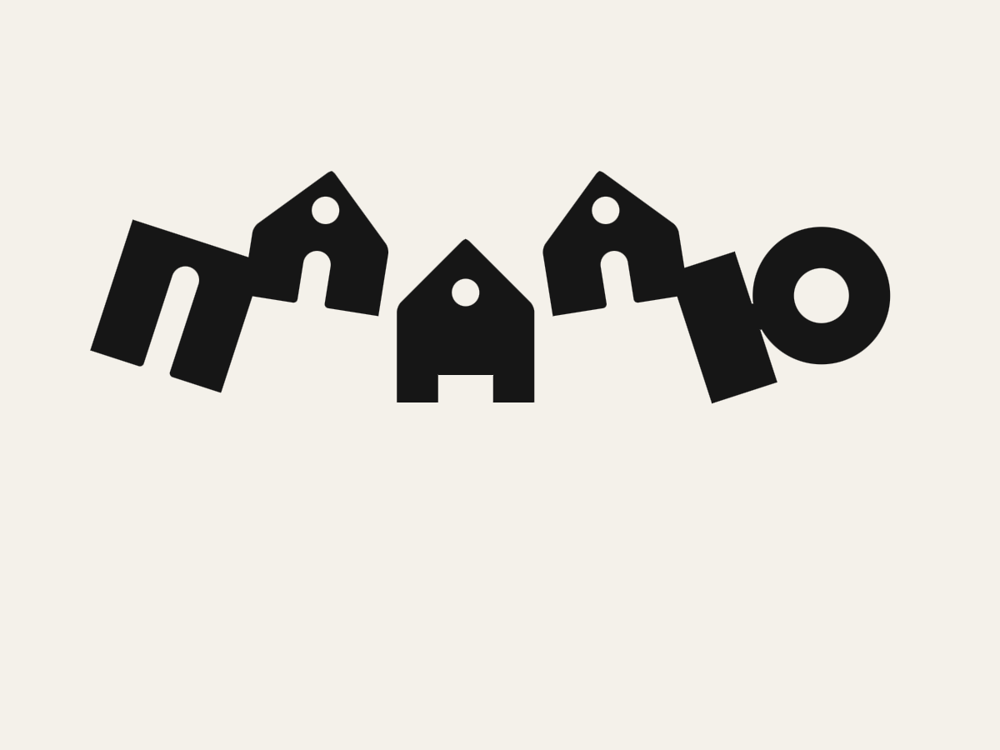<br><b>Падение</b> — буквы становятся твёрдыми телами.<br><a href="https://maelsmo.github.io/aurora_ecipse/?preset=fall">Открыть</a></td>
  </tr>
</table>

## Как это работает

Буква здесь — не контур, а список модулей на сетке. Шейдер считает расстояние от каждой точки холста до этих модулей и до соседних объектов. Поэтому одна и та же геометрия отвечает и на вопрос «где буква», и на вопрос «как далеко до соседней» — отсюда слияния, просветы затмения, полосы и точный вектор.

### Два сета знаков

- **«Основной»** — штрихи на сетке. Высота прописной — пять модулей: штрих, просвет, штрих, просвет, штрих. Кривые только из дуг, окончания — полукруги, вогнутые стыки скругляются одним радиусом. Есть спутники (нога A, хвост Q, точки Ё) и зрачки.
- **«Геометрия»** — клетки и тени. Прописная — плита из больших клеток 2 × 2 (широкие знаки — 3 × 2), а буква — то, что осталось от плиты после теней.

В одной сцене сеты можно смешивать: у каждой буквы свой. Оба редактируются в конструкторе, свои сеты выгружаются и загружаются JSON-файлами.

### Сет «Геометрия»

<p align="center">
  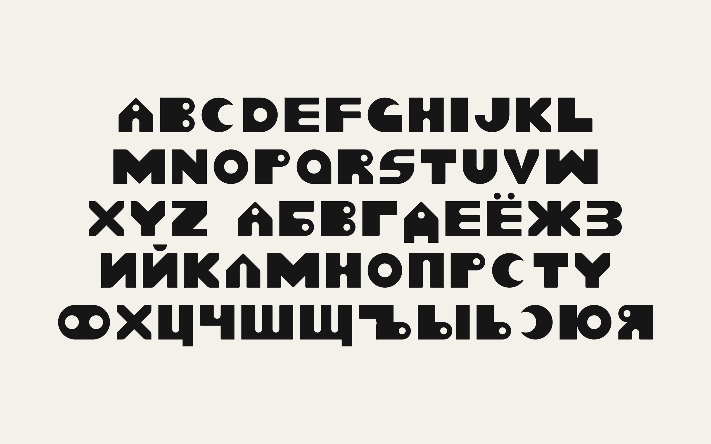
</p>

- **Краска — только клетки**: квадрат, четверть круга или чаша с половинным радиусом. Те же клетки сет даёт как плитки для узоров: ■ ◜ ◠ ● ◆ ◉ ◢ ▤.
- **Просветы — тени** шириной в один модуль: зрачок (круглое отверстие), залив (прорезь от края с круглым концом) или клин (срез под 45°).
- **Круглое и острое.** Круглые и прямые буквы берут зрачки и заливы, диагональные — клинья. U круглая, V — её острая пара; у S заливы, у Z клинья.
- **Затмение.** C, G и Э — диск, на который зашла тень побольше: остаётся серп. O — кольцо, тень стоит точно в центре.
- **Полосы.** Клетка помнит направление: стебли — вертикали, перекладины — горизонтали, скругления — дуги. Тени стоят на сетке в полмодуля, поэтому залив или зрачок убирает линии целиком и ни одну не режет вдоль.

<p align="center">
  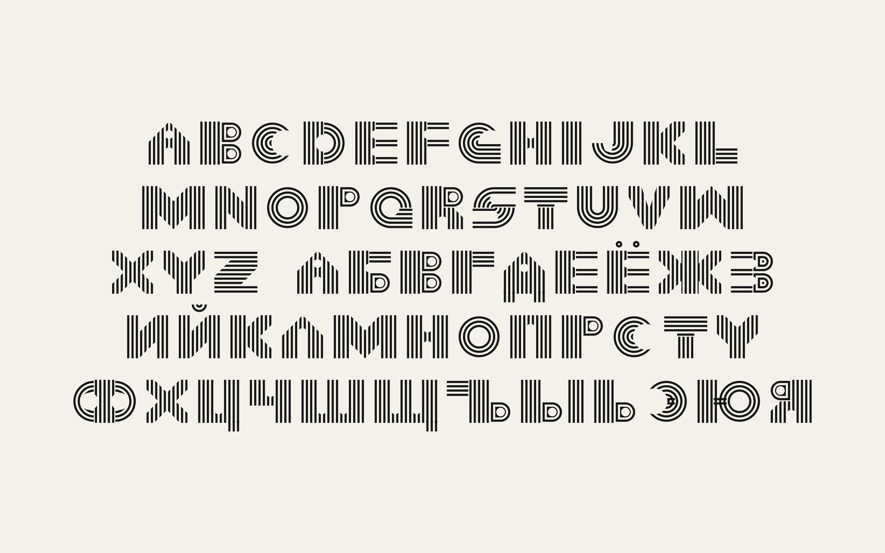
</p>

### Одна конструкция — пять видов

<p align="center">
  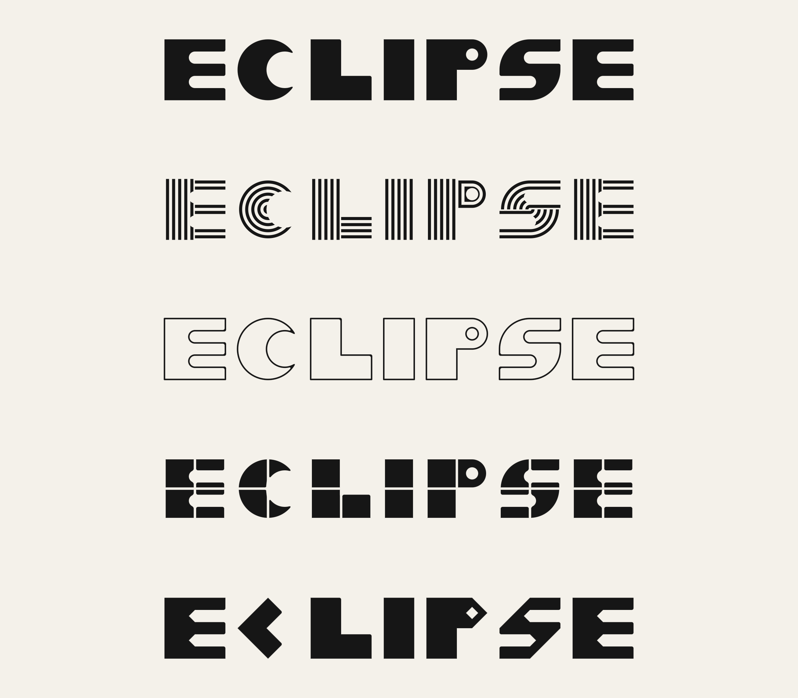
</p>

Сверху вниз: заливка, линии, контур, мозаика (зазор между клетками) и прямые срезы — ось «Окончания» на нуле делает всё круглое гранёным, серп становится шевроном. Ещё есть изолинии и растр. Вид наследуется: сцена → сет → группа → объект, и любая буква может выглядеть по-своему.

<p align="center">
  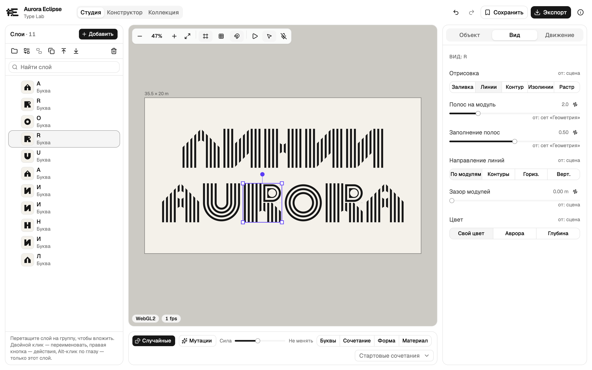
</p>

## Возможности

### Сцена

Дерево слоёв: буквы, фигуры (прямоугольник, эллипс, многоугольник, звезда, линия) и группы до шести уровней, всего до 256 объектов. Рамка выделения как в привычных редакторах: сдвиг, масштаб, поворот, размеры фигур.

- **Группа «Независимо»** — объекты рисуются каждый сам по себе; группа задаёт общий сдвиг, поворот, масштаб, прозрачность и вид.
- **Сплав** — формы сочетаются операторами: объединение, слияние с перемычкой, затмение, врезка, вырезание, пересечение, исключение, перетекание.
- **Маска** — нижний объект группы обрезает остальные: буква, заполненная узором.
- **Материал** сцены: фон, корона, тень, зерно, полутень наложений.
- **Артборд** — кадр композиции. По нему кадрируется экспорт, 1 модуль = 10 мм.

### Клонеры и эффекторы

Любая группа становится клонером и раскладывает своих детей сеткой, по кругу, по линии или россыпью — до 4096 клонов на сцену.

- **Чередование по зонам**: по порядку, случайно, рядами, колонками, кольцами, ромбами, диагоналями, шахматкой. Зона выбирает, каким ребёнком стать клону, и цвет из палитры.
- **Симметрия по четвертям**: зеркало или поворот на 90° — из одной плитки складывается розетка.
- **Эффекторы**: случайность, шум, волна, поле вокруг курсора или центра. Каждый двигает, поворачивает, масштабирует, гасит и перекрашивает клоны.

### Физика

<p align="center">
  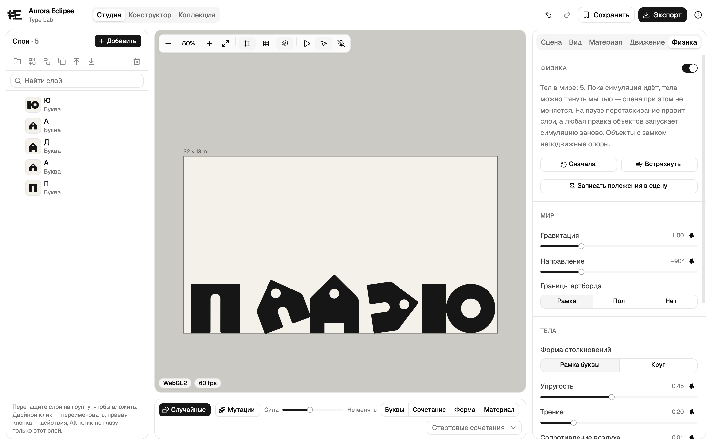
</p>

Буква, фигура, клон или сплав становятся твёрдым телом: гравитация с направлением, упругость, трение, стены артборда. Курсор отталкивает, притягивает или закручивает; поле в центре дует ветром или пульсирует. Пока симуляция идёт, тела можно тянуть и бросать мышью. Шаг фиксированный, поэтому сцена каждый раз разыгрывается одинаково, а положения можно записать обратно в слои.

### Динамика

- **Сигналы**: четыре ритма (синус, треугольник, шум, пульс), курсор (положение, близость, скорость, нажатие) и микрофон (громкость, низкие и высокие частоты). Звук анализируется в браузере и не записывается.
- **Связи**: значок волны у любого ползунка привязывает его к сигналу — с силой, инверсией и порогом.
- **Движение слоя**: орбита, дрейф, маятник, дыхание, следование за курсором или уход от него.
- **Деформации**: волна, текучесть, линза курсора.

### Конструктор

<p align="center">
  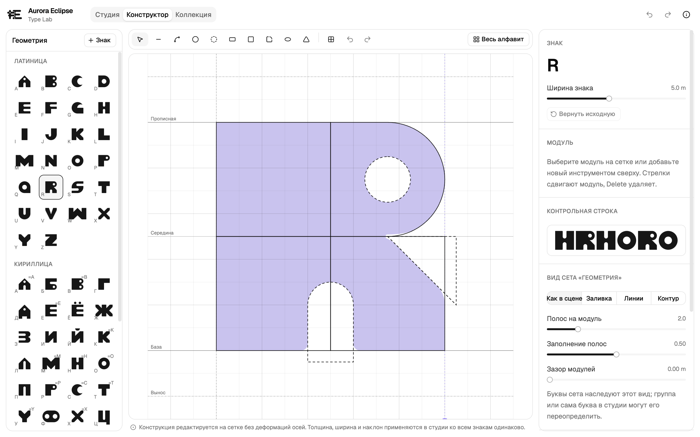
</p>

Редактор модулей на сетке для обоих видов сетов: штрихи, дуги, спутники, зрачки и прорези — или клетки, четверти, эллипсы и клинья. Рядом ширина знака, контрольная строка и лист всего алфавита.

### Экспорт

| Формат | Что внутри |
|---|---|
| **SVG** | Точные контуры: прямые и кривые Безье, цвет каждой буквы отдельной областью. Клоны описаны один раз и расставлены ссылками. Линии и контуры выгружаются осевыми штрихами — подходит для плоттера и лазера. |
| **PNG** | ×1, ×2, ×4 — до 7680 px по длинной стороне, фон по желанию прозрачный. |
| **MP4** | Покадровый расчёт: H.264, 720p / 1080p / 4K, 30 или 60 кадров/с. С начала сцены, а при идущей физике — с положений тел на экране. |
| **WebM** | Запись холста в реальном времени — когда нужен живой курсор или микрофон. |
| **JSON** | Рецепт: сцена и использованные сеты. Открывается обратно в редакторе. |

<details>
<summary><b>Горячие клавиши</b></summary>

| Клавиши | Действие |
|---|---|
| ⌘Z / ⇧⌘Z | Отменить, повторить |
| ⌘S / ⌘E | Сохранить в коллекцию, экспорт |
| ⌘G / ⌥⌘G / ⇧⌘G | Группа, сплав, разгруппировать |
| ⌘D / ⌘A | Дублировать, выбрать всё |
| ⇧⌘H / ⇧⌘L | Скрыть, закрепить |
| [ и ] | Ниже, выше |
| F2 / Delete / Esc | Переименовать, удалить, снять выделение |
| Стрелки | Сдвиг выделения, с Shift — мельче |
| ⌘ + колесо | Масштаб холста |

Сочетания работают в любой раскладке, включая русскую.

</details>

## Для разработчиков

Нужен свежий Node.js: сборка на CI идёт на текущей LTS-версии.

```sh
npm ci
npm run dev        # http://localhost:5173
npm test           # геометрия, сцена, клонеры, физика, экспорт
npm run build      # проверка TypeScript и сборка в dist/
```

React 19, Vite, Tailwind 4, zustand; интерфейс — стоковые компоненты shadcn/ui, бренд живёт только на холсте. Рендер — WebGL2, физика — matter-js (загружается при включении), MP4 — WebCodecs и mediabunny.

Каждый push в `main` прогоняет тесты и публикует сборку на GitHub Pages: [`.github/workflows/deploy.yml`](.github/workflows/deploy.yml).

<details>
<summary><b>Архитектура</b></summary>

```
src/engine/
  grid.ts axes.ts types.ts            метрики, оси, типы модулей
  alphabet/                           «Основной» (latin, cyrillic), «Геометрия» (geo), сеты (sets)
  compile.ts shapes.ts                правила и фигуры → абсолютная геометрия для заданных осей
  sdf.ts operators.ts frame.ts        CPU-эталон: расстояния, операторы, кадр (дерево, клонеры, маски)
  cloner.ts effectors.ts noise.ts     раскладки, зоны, симметрия; эффекторы; переносимый шум
  physics.ts                          мир matter-js поверх кадра
  gpu/glsl/ pack.ts renderer.ts       GLSL, data-текстуры RGBA32F, инстансный WebGL2-рендер
  gpu/thumbs.ts                       общий offscreen-контекст для миниатюр и PNG
  scene/                              модель v3, дерево, миграция v2 → v3, санитайзер, набор текста
  params.ts signals.ts modulation.ts  реестр параметров и путей, сигналы, модуляция, движение
  presets.ts variations.ts            сочетания, узоры, контексты, варианты
  export/                             трассировка, области, SVG, полосы, видео, воркер
src/state/                            zustand-стор, живой рантайм кадра, экспорт
src/components/                       studio/, constructor/, collection/, shared/, ui/ (shadcn)
```

Шейдер и `sdf.ts` / `operators.ts` / `frame.ts` зеркальны: меняя одно, меняйте и другое. В dev-режиме `?debug=parity` сравнивает GPU-рендер с CPU-эталоном на всех пресетах. Ядро расстояний не зависит от рендера — на нём строятся и вектор, и будущие 3D и мерч.

Ссылка вида `?preset=rosette` открывает стартовую сцену или узор по идентификатору из `src/engine/presets.ts`.

</details>
